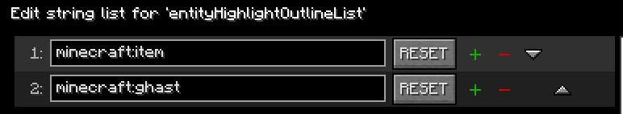
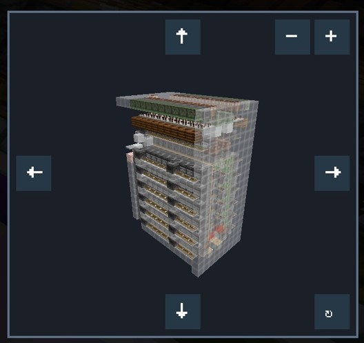

# ListMore
**English** · [简体中文](README.md)
## Features

- **Copy Target ID**: Copy the ID of the block or entity pointed by the cursor.

- **Entity Highlight Outline**: Render enabled entity types with a glowing outline.

- **Selective Entity Highlight Outline**: One entity ID per line.

  

- **Entity Highlight Outline Color**: Set the outline color for selected entities.

- **Entity Rendering Blacklist**: Skip client-side rendering for enabled entity types in the blacklist.

- **Entity Rendering Blacklist Entries**: One entity ID per line.

- **Entity Rendering Blacklist Range**: Blacklisted entities render again inside this three-dimensional range; 0 always hides them.

- **Invalid Furnace Input Highlighter**: Highlights furnaces whose input slot contains an item with no smelting recipe. Single-player only for now.

- **Invalid Furnace Input Highlighter Range**: Scan radius in chunks, centered on the player's current chunk.

- **TNT Explosion Preview**: Preview nearby TNT block destruction with red and yellow markers. Red marks the conservative range, and yellow marks the additional possibly affected range.

- **TNT Explosion Preview - Display Mode**: Choose whether to display possible destruction blocks (`Full Preview` / `Partial Preview`).

- **Projectile Landing Prediction**: Show the predicted landing point for supported projectiles.

- **Schematic Dynamic Preview**: Replace Litematica's static schematic thumbnail with a real-time 3D preview. Requires Litematica.

  

- **Single Block Mining**: Mine at most one block per attack press; release and press again to mine another.

- **Single Block Placement**: Place at most one block per use press; release and press again to place another.

## Supported Versions

|Minecraft Version|Mod Loader|Status|
|---|---|---|
|1\.21\.8|Fabric|Supported|
|1\.21\.10|Fabric|Supported|
|1\.21\.11|Fabric|Supported|
|26\.1\.2|Fabric|Supported|
|26\.2|Fabric|Supported|
|26\.3|Fabric|Supported|

## Dependencies & Installation

- Required dependencies: Fabric Loader, Fabric API, [MaLiLib](https://modrinth.com/mod/malilib).

- **Schematic Dynamic Preview** also requires [Litematica](https://modrinth.com/mod/litematica). All other features remain available without it.

## Feedback

Please report issues and suggestions via [GitHub Issues](https://github.com/Fenad2/ListMore/issues). The source code is available at [Fenad2/ListMore](https://github.com/Fenad2/ListMore).

## License

This project is licensed under [LGPL\-3\.0](https://www.doubao.cn).
